# JoinUp - найди свою компанию

**JoinUp** - это приложение для тех, кто часто задается **вопросом**: *"чем мне заняться на выходных?"*, ну или просто любит находить новые знакомства😊. \
С его помощью вы можете **создавать события** о поиске компании на вечер, друзей по интересам или товарища для онлайн игры. \
В приложении предусмотрен **поиск** с разнообразными фильтрами, **подписка** на рыссылку об интересующих вас событиях, привязка событий к **telegram-чатам** и многие другие функции, которые помогут вам легко и быстро организовать свой досуг.

## Предметная область
**Прдметная область** данного приложения - создание и поиск событий для организации досуга. \
Основные **сущности** предметной области:
- **Пользователь**
- **Событие** (то же, что и *мероприятие*)
- **Категория** (для классификации событий)
- **Участник** (пользователь, который принимает участие в мероприятии)
- **Локация** (где проводится мероприятие)
- **Уведомление** (сообщение пользователю о том, что появилось событие с определенным набором категорий)
- **Подписка** (отслеживать события, создаваемые определенным пользователем)
- **Пресет** (сохраненный набор категорий для быстрого поиска)

## Сравнительный анализ

> оценка по 5-балльной шкале, где 1 - плохо, 5 - отлично

| Приложение | Доступность в РФ | Удобство использования | Интеграция с соц.сетями | Универсальность |
|-------------|-------------|-------------|-------------|-------------|
| MeetUp  | нет | 4  | нет | 5 |
| Mobilizon | нет  | 3  | нет | 5 |
| Группы в соц.сетях| да  | 5 | да | 2 |
| JoinUp  | да  | 4  | да | 5 |

## Актуальность

Данное приложение нацелено на улучшение социального взаимодействия людей, что является актуальной темой для многих подростков и не только. На момент 2026 года в России нет аналогичных популярных решений.

## Роли
- **Пользователь** - лицо, использующее приложение по прямому назначению. Пользователю доступен весь *"наружный"* функционал приложения.
- **Админ** - лицо, отвечающее за модерацию и поддержку работоспособности приложения. Достпен тот же функционал, что и *пользователю*, но с дополнительными возможностями, например редактировать и удалять чужие объявления.
- **Бот** - роль, предназначенная для использования telegram-ботом. Имеет ограниченный функционал (не может создавать объявления и т.д.).

## Use-Case диаграмма

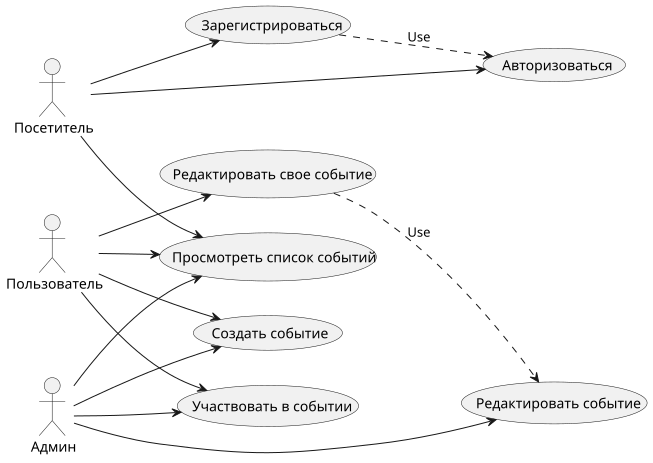

## ER-диаграмма сущностей

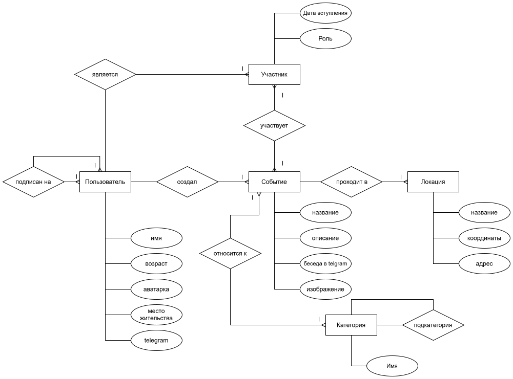

## Пользовательские сценарии

- **Создание события**
    1. *Пользователь* нажимает кнопку `создать событие`
    2. *Пользователь* заполняет обятельные и необязательные поля, описывающие события
    3. Другие *пользователи* теперь могут видеть это событие на странице **событий**, а также получат уведомление, если таковое должно им прийти
- **Поиск события**
    1. *Пользователь* выбирает нужные категории (фильтры) и нажимает кнопку `искать`
    2. *Пользователь* выбирает интересующее его событие и нажимает `присоединиться`. В случае если места на этом **событии** еще есть, *пользователь* становится **участником** данного **события**
    3. Теперь этот *пользователь* может посмотреть закрытые детали события а также перейти в беседу в *telegram*, связанную с этим событием
- **Удаление события администратором**
    1. *Админ* видит **событие**, нарущающее правила использования приложения.
    2. *Админ* нажимает кнопку `удалить событие` и отправляет создателю события предупреждение
    3. Если *пользователь* имеет несколько предупреждений, *админ* может заблокировать данного *пользователя*

## Формализация ключевых бизнес-процессов


## Описание типа приложения и стек
Web SPA
- Бекенд: Go
- Фронтенд: TypeScript + React
- СУБД: PostgreSQL

Для взаимодействия фронтенда и бекенда используется REST API

## C4

### L1
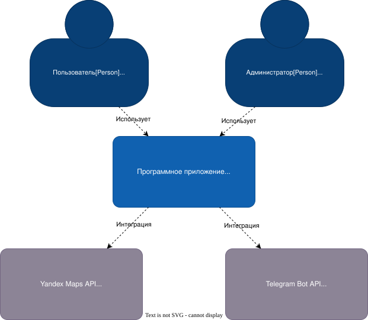

### L2
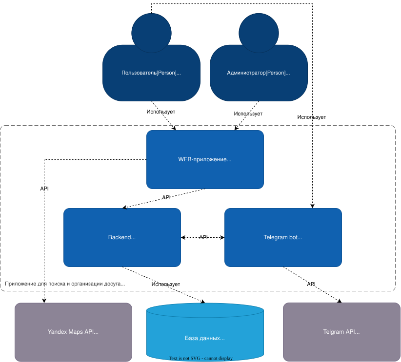

### L3
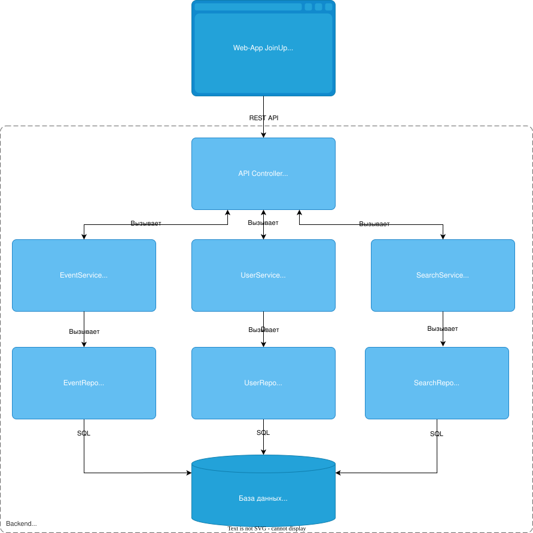

### L4
#### Компонент доступа к данным
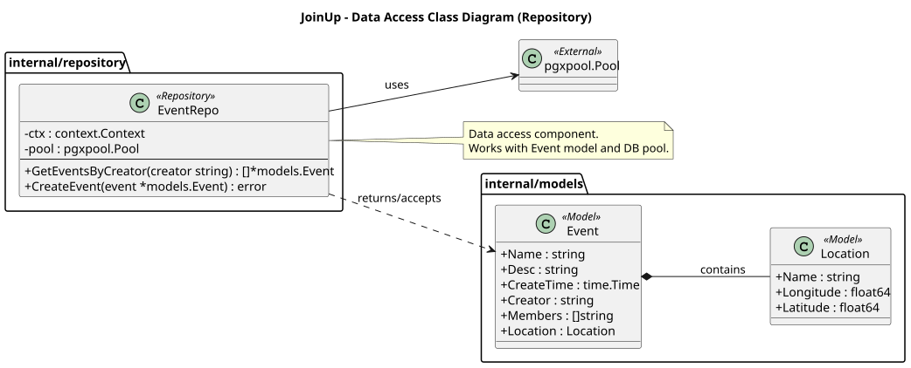

#### Компоненты бизнес-логики

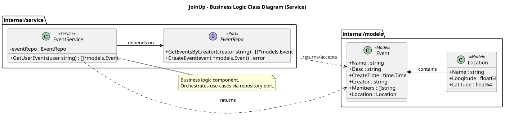

## Диграммы последовательностей

### Авторизация пользователя
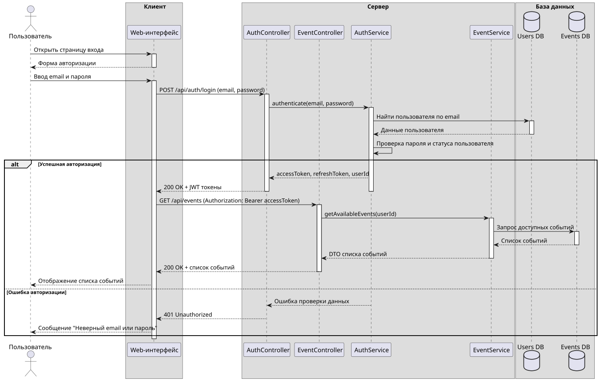

### Создание события
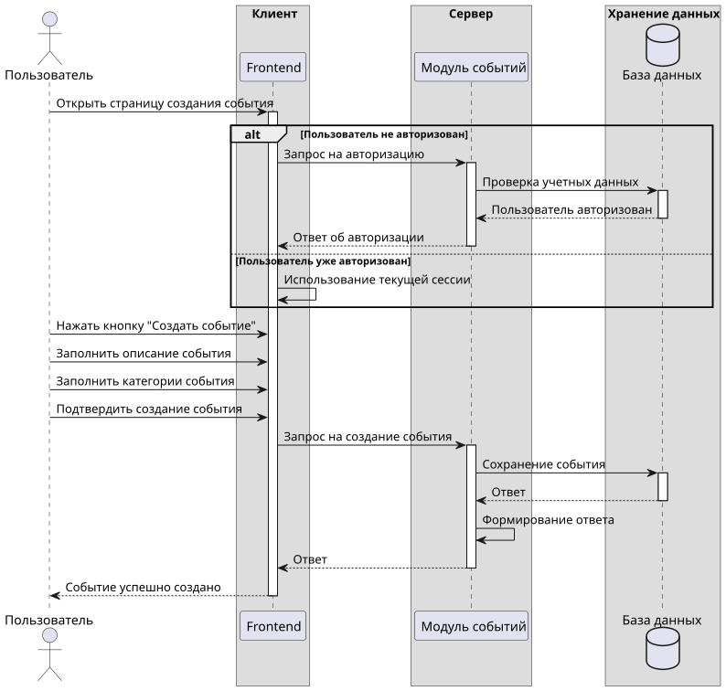

### Редактирование события
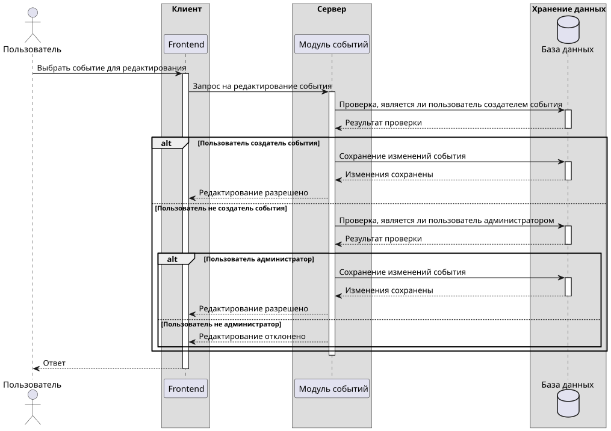

## DBML базы данных
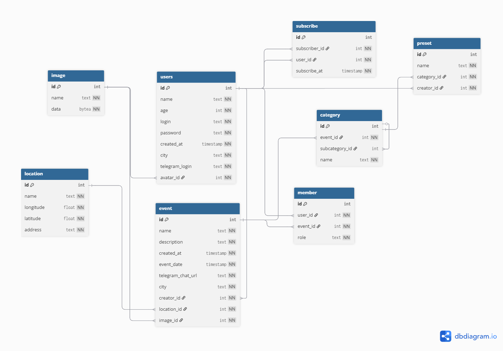
