# JoinUp - найди свою компанию

**JoinUp** - это приложение для тех, кто часто задается **вопросом**: *"чем мне заняться на выходных?"*, ну или просто любит находить новые знакомства😊. \
С его помощью вы можете **создавать события** о поиске компании на вечер, друзей по интересам или товарища для онлайн игры. \
В приложении предусмотрен **поиск** с разнообразными фильтрами, **подписка** на рыссылку об интересующих вас событиях, привязка событий к **telegram-чатам** и многие другие функции, которые помогут вам легко и быстро организовать свой досуг.

## Цель и решаемая проблема

**Цель:** предоставить пользователю web-приложение для поиска компании по интересам и организации совместного досуга.

Объявления в общих лентах и чатах затрудняют поиск по месту, времени и тематике, а организатору приходится вручную учитывать участников. JoinUp объединяет поиск мероприятий, публикацию объявлений, запись участников и отзывы об организованных встречах.

## Предметная область
**Прдметная область** данного приложения - создание и поиск событий для организации досуга. \
Основные **сущности** предметной области:
- **Пользователь**
- **Событие** (то же, что и *мероприятие*)
- **Категория** (для классификации событий)
- **Участник** (пользователь, который принимает участие в мероприятии)
- **Локация** (где проводится мероприятие)
- **Уведомление** (сообщение пользователю о том, что появилось событие с определенным набором категорий)
- **Подписка** (отслеживать события, создаваемые определенным пользователем)
- **Пресет** (сохраненный набор категорий для быстрого поиска)

## Сравнительный анализ

> оценка по 5-балльной шкале, где 1 - плохо, 5 - отлично

| Приложение | Доступность в РФ | Удобство использования | Интеграция с соц.сетями | Универсальность |
|-------------|-------------|-------------|-------------|-------------|
| MeetUp  | нет | 4  | нет | 5 |
| Mobilizon | нет  | 3  | нет | 5 |
| Группы в соц.сетях| да  | 5 | да | 2 |
| JoinUp  | да  | 4  | да | 5 |

## Актуальность

Данное приложение нацелено на улучшение социального взаимодействия людей, что является актуальной темой для многих подростков и не только. На момент 2026 года в России нет аналогичных популярных решений.

## Роли
- **Пользователь** - лицо, использующее приложение по прямому назначению. Пользователю доступен весь *"наружный"* функционал приложения.
- **Админ** - лицо, отвечающее за модерацию и поддержку работоспособности приложения. Достпен тот же функционал, что и *пользователю*, но с дополнительными возможностями, например редактировать и удалять чужие объявления.
- **Бот** - роль, предназначенная для использования telegram-ботом. Имеет ограниченный функционал (не может создавать объявления и т.д.).

## Требования

### Функциональные требования

| ID | Требование |
| --- | --- |
| ФТ-1 | Регистрация, вход, просмотр профиля и изменение собственных данных. |
| ФТ-2 | Поиск неудалённых событий по названию, городу, диапазону дат и сочетанию категорий; просмотр карточки без регистрации. Событие должно содержать все выбранные категории. |
| ФТ-3 | Создание события с названием, датой, городом и местом; добавление описания, категорий, обложки и ссылки на чат. Изменение собственных будущих событий и удаление своих объявлений. |
| ФТ-4 | Запись на предстоящее событие, отказ от участия, просмотр участников; повторная запись одного пользователя запрещена. |
| ФТ-5 | Просмотр списков «Мои события» и «Я участвую». |
| ФТ-6 | Изменение чужих будущих событий и удаление чужих объявлений администратором; журналирование мягкого удаления. |
| ФТ-7 | Просмотр отзывов и рейтинга организатора. После наступления времени события пользователь, кроме его организатора, может оставить один отзыв: оценка 1–5, текст 1–2000 символов. |

Требования этого раздела описывают реализованный вариант приложения по [аналитической части отчёта](report/05-analysis.tex). Организатор — пользователь, создавший конкретное событие. Рассылки, подписки и бот, упомянутые в первоначальном описании проекта, в этот вариант не входят.

### Ключевые нефункциональные требования

Ниже сформулированы измеримые критерии приёмки. Норматив производительности добавлен для этой лабораторной; остальные критерии конкретизируют требования существующего отчёта. Новые проверки при подготовке документа не выполнялись.

| Характеристика | Измеримое требование | Способ проверки |
| --- | --- | --- |
| Производительность | Среднее время основного SQL-запроса поиска с индексом — не более **10 мс** на 10 000 событий и 12 006 локаций, при прогретом кеше, без параллельной нагрузки, для Москвы и интервала 26.08–25.10.2026, без фильтров названия и категорий. | 500 измерений `Execution Time` через `EXPLAIN ANALYZE` на стенде существующего исследования: Ryzen 7 7700, 32 ГБ, Windows 11 / WSL 2, PostgreSQL 16.11. |
| Надёжность | Создание события и новой локации атомарно: при ошибке до фиксации транзакции остаётся **0 частично созданных пар**. Для одной пары пользователь–событие допускается не более **1 записи участия** и **1 отзыва**. | Сравнить состояние БД до и после ошибки создания; при повторных и конкурентных запросах проверить отсутствие дубликатов. |
| Безопасность | **100% запросов к защищённым операциям** без действительного JWT отклоняются с HTTP 401. Изменение или удаление чужого существующего события обычным пользователем отклоняется с HTTP 403; данные не изменяются. Пароли **100% аккаунтов, создаваемых через API**, хранятся как bcrypt-хеши. | Проверить матрицу «гость / автор / другой пользователь / администратор», ответы API и состояние БД; проверить формат сохранённых паролей. |
| Доступность интерфейса | Основные сценарии выполняются в браузере без установки отдельного клиентского приложения. | Пройти регистрацию, поиск, создание и участие через web-интерфейс. |

В [существующем исследовании](report/08-research.tex) для указанного SQL-запроса получено **3,038 мс** с индексом и **4,905 мс** без индекса. Это ранее полученные результаты, а не новое измерение; они не характеризуют время HTTP-ответа или загрузки всей страницы.

## Use-Case диаграмма

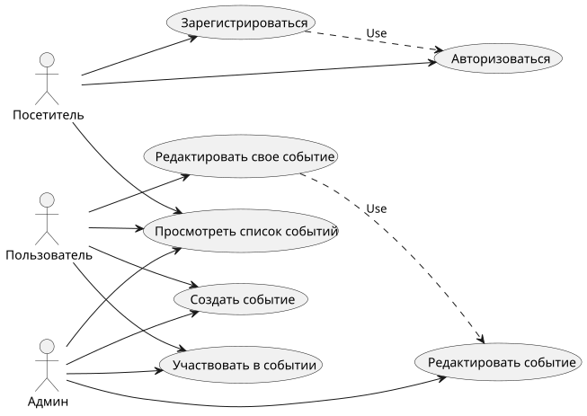

## ER-диаграмма сущностей

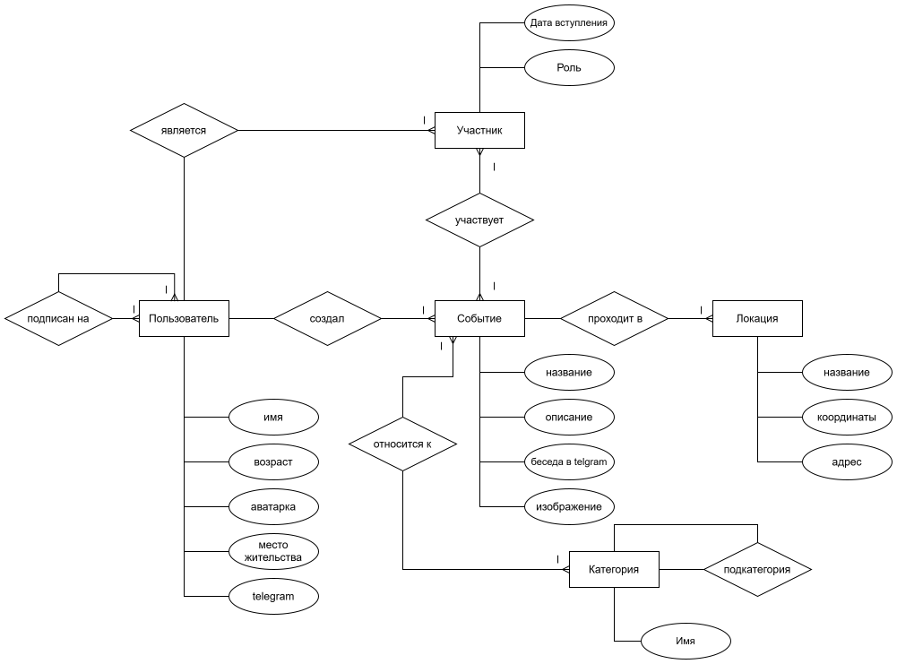

## Пользовательские сценарии

- **Создание события**
    1. *Пользователь* нажимает кнопку `создать событие`
    2. *Пользователь* заполняет обятельные и необязательные поля, описывающие события
    3. Другие *пользователи* теперь могут видеть это событие на странице **событий**, а также получат уведомление, если таковое должно им прийти
- **Поиск события**
    1. *Пользователь* выбирает нужные категории (фильтры) и нажимает кнопку `искать`
    2. *Пользователь* выбирает интересующее его событие и нажимает `присоединиться`. В случае если места на этом **событии** еще есть, *пользователь* становится **участником** данного **события**
    3. Теперь этот *пользователь* может посмотреть закрытые детали события а также перейти в беседу в *telegram*, связанную с этим событием
- **Удаление события администратором**
    1. *Админ* видит **событие**, нарущающее правила использования приложения.
    2. *Админ* нажимает кнопку `удалить событие` и отправляет создателю события предупреждение
    3. Если *пользователь* имеет несколько предупреждений, *админ* может заблокировать данного *пользователя*


## Формализация ключевых бизнес-процессов


На диаграмме из [исходника draw.io](images/bpmn.drawio) представлены **три отдельных нелинейных процесса**:

| Процесс | Основной путь | Ветвления |
| --- | --- | --- |
| Авторизация и переход к поиску | Вход → список событий → фильтрация → результат. | Есть ли учётная запись; хочет ли гость зарегистрироваться; продолжить работу или уйти. |
| Создание события | Открыть форму → заполнить описание и категории → подтвердить создание. | Переход гостя через проверку учётной записи и авторизацию; путь уже вошедшего пользователя. |
| Редактирование события | Выбрать событие → проверить права → изменить сведения. | Пользователь — создатель / не создатель; во втором случае — администратор / нет доступа. |

Круги обозначают события начала и завершения, скруглённые прямоугольники — задачи, ромбы — шлюзы выбора, стрелки — потоки управления. Дорожки разделяют роли участников.


## Описание типа приложения и стек
Web SPA
- Бекенд: Go
- Фронтенд: TypeScript + React
- СУБД: PostgreSQL

Для взаимодействия фронтенда и бекенда используется REST API

Фреймворки и инструменты: **Go 1.25 + Echo v5**, **pgx/v5** для доступа к данным, **Goose v3** для миграций; **React 18 + TypeScript + Vite** на фронтенде; **PostgreSQL 16**. Выбор и отображение места выполняются через API Яндекс Карт.

**Механизм доставки:** браузер загружает HTML/CSS/JS; `npm run build` собирает frontend в `frontend/dist`. В учебном окружении frontend запускается через Vite с проксированием `/api` на backend, backend — отдельным Go-процессом, PostgreSQL — Docker-контейнером с постоянным томом. Публикация статической сборки на одном origin с API предусмотрена в описании frontend; готовый production-конвейер доставки не заявляется.

Источники: [go.mod](app/go.mod), [package.json](frontend/package.json), [Makefile](app/Makefile), [описание frontend](frontend/README.md).

## C4

### L1

Context — контекст системы.

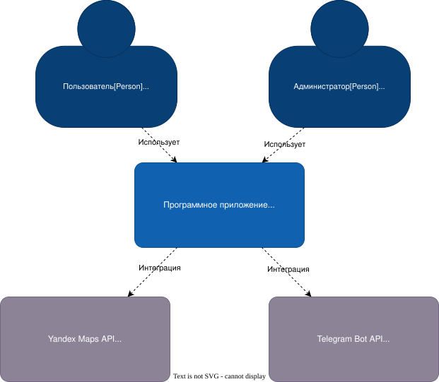

### L2

Container — контейнеры системы.

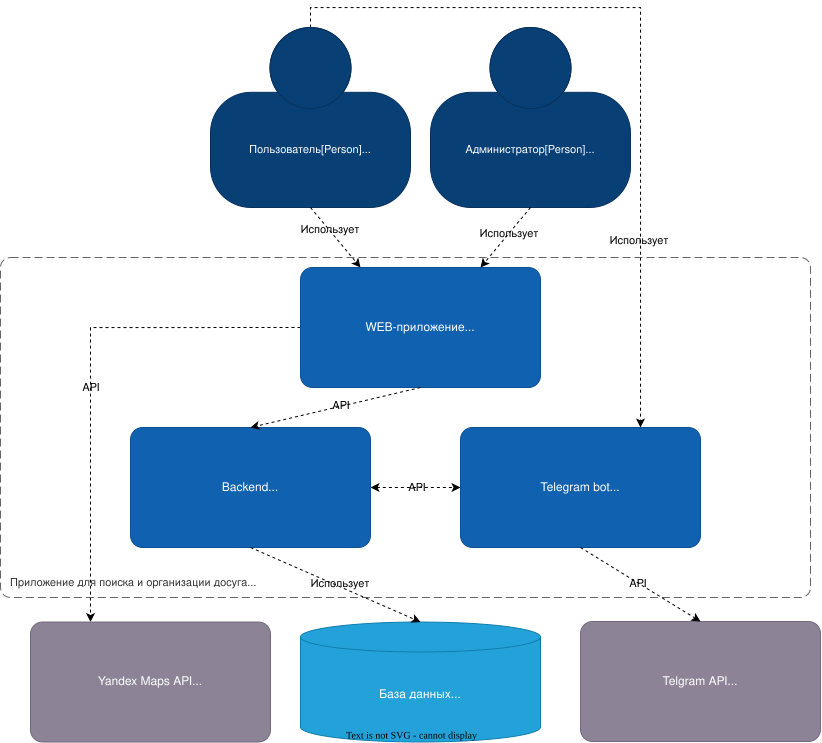

### L3

Component — компоненты backend.

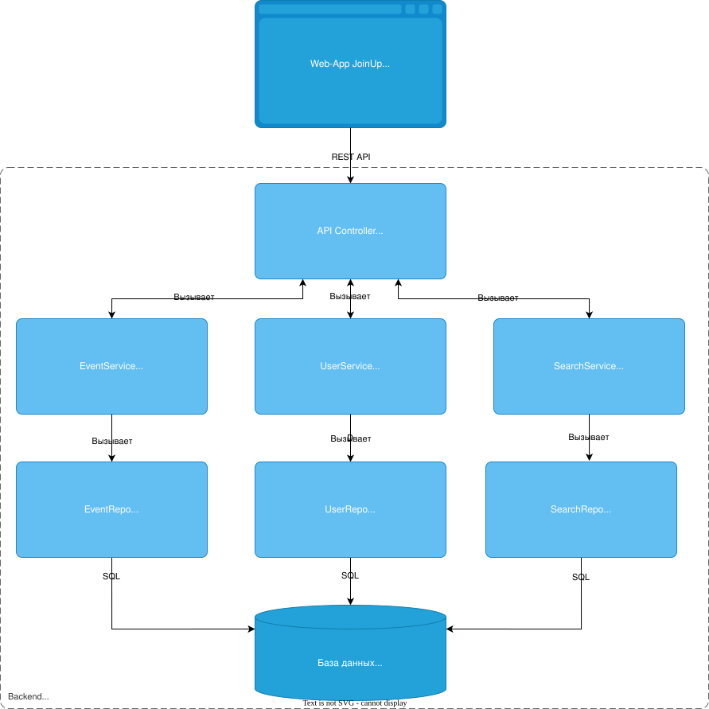

### L4
#### Компонент доступа к данным
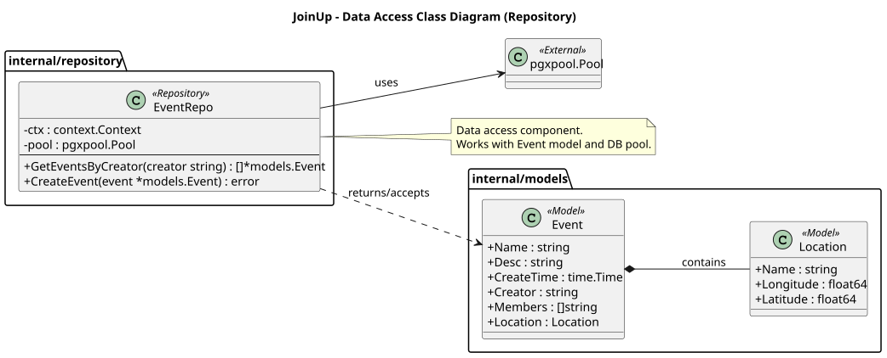

#### Компоненты бизнес-логики

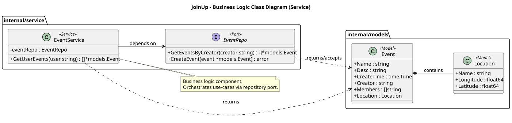

## Диграммы последовательностей

### Авторизация пользователя
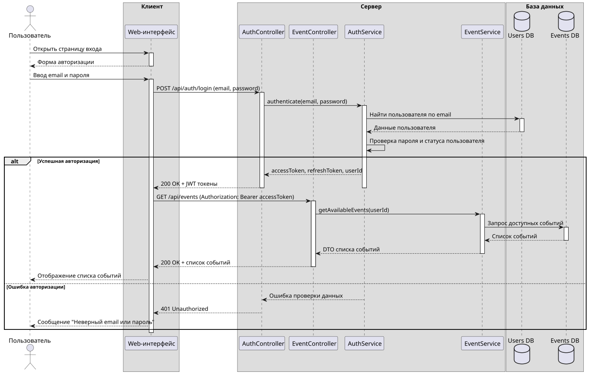

### Создание события
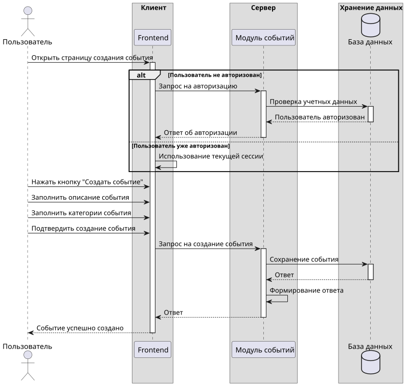

### Редактирование события
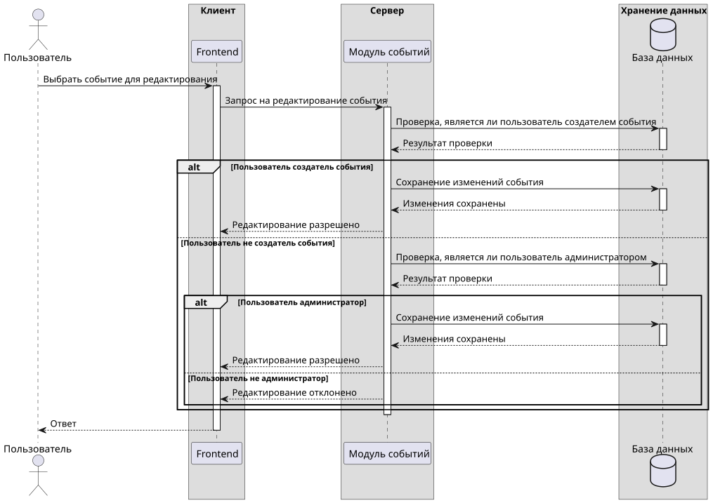

## DBML базы данных
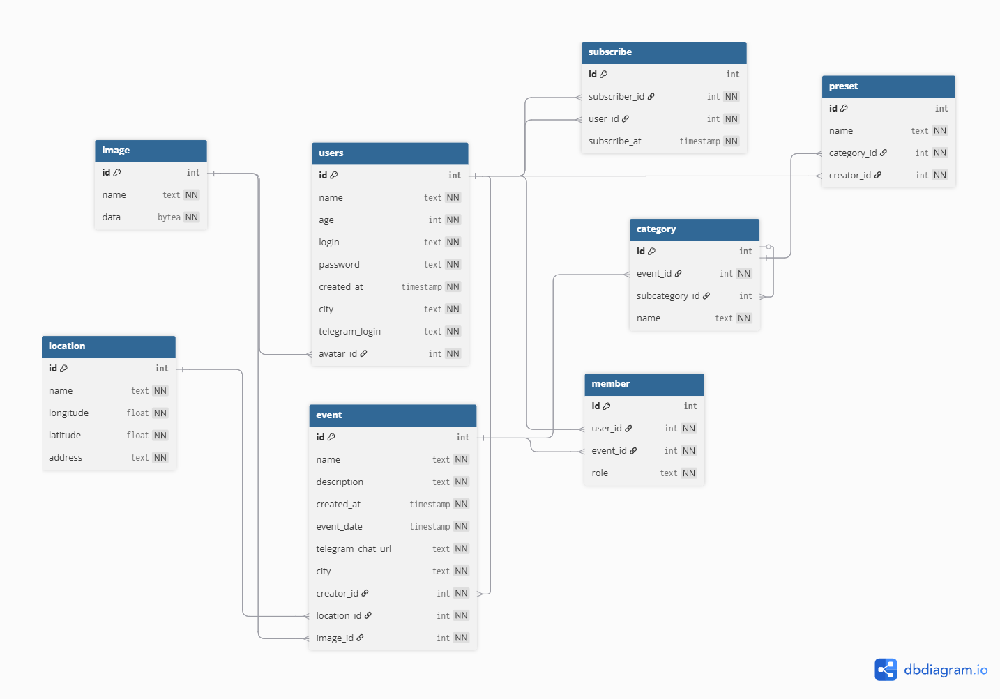

## Архитектурные решения (ADR)

Записи ниже фиксируют уже принятые в проекте решения; причины сведены из отчёта и структуры реализации.

### ADR-001. PostgreSQL для реляционной модели

**Статус:** принято для рассматриваемого варианта приложения.

**Решение:** хранить пользователей, события, участие, категории и отзывы в PostgreSQL; обеспечивать связи и уникальность ограничениями БД, согласованность составных операций — транзакциями, журнал удаления — триггером.

**Альтернативы:** MySQL, SQLite; в коде также предусмотрен MongoDB-адаптер.

**Причины выбора:** предметная область содержит связанные сущности и отношения многие-ко-многим. PostgreSQL соответствует требуемым ограничениям, транзакциям, триггерам и разграничению прав ролями БД; схема и миграции проекта уже используют эти возможности. MySQL рассматривалась как подходящий реляционный вариант; SQLite не отвечает требованию серверных ролей с `GRANT`/`REVOKE`. MongoDB представляет отдельный вариант хранения и не используется для физической схемы этой работы.

**Последствия:** изменения структуры проходят через миграции; приложение зависит от доступности БД, а PostgreSQL-специфичные запросы, роли и триггер требуют адаптации при смене СУБД.

### ADR-002. Слои контроллеров, сервисов и репозиториев в одном backend

**Статус:** принято.

**Решение:** один Go backend с разделением HTTP-обработчиков, бизнес-логики и доступа к данным; React SPA взаимодействует с ним через REST API. Зависимости собираются в `cmd/server`, транзакции передаются репозиториям через `UOW` и контекст операции.

**Альтернативы:** SQL и бизнес-правила непосредственно в HTTP-обработчиках; отдельные микросервисы пользователей, событий и отзывов.

**Причины выбора:** существующие сценарии работают с общими данными и требуют транзакций. Разделение слоёв сохраняет правила предметной области вне HTTP и SQL; единый процесс упрощает запуск учебного приложения. Микросервисы добавили бы сетевое взаимодействие и согласование операций между сервисами без необходимости для заданного объёма.

**Последствия:** API и бизнес-логика развёртываются вместе; смена хранилища затрагивает адаптеры репозиториев, но не требует переноса HTTP-логики. Независимое масштабирование отдельных сервисов не предусмотрено.


## Лабораторная работа №2. Публичное REST API

Основной результат — [OpenAPI 3.1 YAML](app/api/openapi.yaml). `/api/v1` заменён ресурсным API; SPA и CLI переведены на новые маршруты. Контракт встроен в Go-бинарник и доступен по `/openapi.yaml`, интерфейс просмотра — `/swagger/index.html`.

### Ресурсы и достаточность методов

| Ресурс | Методы и назначение |
| --- | --- |
| `/api/v1/tokens` | `POST`: выдать JWT по логину и паролю в JSON. |
| `/api/v1/users` | `POST`: регистрация. |
| `/api/v1/users/{id}`, `/api/v1/users/me` | `GET` профиля по ID; `PUT` редактируемой части собственного профиля. |
| `/api/v1/events`, `/api/v1/events/{id}` | `GET` списка с фильтрами, `POST` создания; `GET`, `PUT`, `PATCH`, `DELETE` отдельного события — полный CRUD. |
| `/api/v1/users/me/events`, `/api/v1/users/me/participations` | `GET` созданных событий и событий с моим участием. |
| `/api/v1/events/{id}/participants/me` | `PUT` записи и `DELETE` отказа; пользователь определяется по JWT. |
| `/api/v1/categories` | `GET` справочника. |
| `/api/v1/events/{id}/categories/{categoryId}` | `PUT` назначения категории; весь набор заменяется через `PUT`/`PATCH` события. |
| `/api/v1/images`, `/api/v1/images/{id}` | `POST` загрузки, `GET` бинарных данных. |
| `/api/v1/events/{id}/images` | `POST` загрузки и назначения обложки одной операцией. |
| `/api/v1/events/{id}/reviews` | `GET` отзывов, `POST` отзыва текущего пользователя. |

Событие — самостоятельный ресурс с жизненным циклом. Участие и назначение категории — адресуемые связи. Локация входит в представление события: самостоятельное управление адресами не требуется сценариями. Рейтинг вычисляется и возвращается в профиле; пароль и технический журнал удаления публичными ресурсами не являются. CRUD не нужен для каждого справочника: методы покрывают действия приложения, а управление словарями, удаление аккаунта и редактирование отзывов в требования не входят.

Поиск — `GET /api/v1/events?city=Москва&category_id=1&category_id=2`; фильтры комбинируются через AND. Создание возвращает `201 Created` и `Location` для пользователя, события и изображения. Изменение и удаление — `204 No Content`. Повторные `PUT` участия/категории и `DELETE` участия/события возвращают 204 при уже достигнутом состоянии. Мягко удалённое событие сохраняет представление с `deleted=true`, но исключается из списков. Для защищённых операций требуется `Authorization: Bearer <JWT>`.

### Частичное изменение

Пример запроса (показан для последующего выполнения):

```http
PATCH /api/v1/events/1 HTTP/1.1
Host: localhost:8080
Authorization: Bearer <JWT>
Content-Type: application/merge-patch+json

{"name":"Обновлённая встреча","location":{"name":"Главный вход"},"image_id":null}
```

Успешный ответ — `204 No Content`. Формат — [JSON Merge Patch, RFC 7396](https://www.rfc-editor.org/rfc/rfc7396.html): пропущенные поля сохраняются, вложенные объекты объединяются, массив категорий заменяется целиком. `null` очищает необязательное поле. Удаление обязательного поля и изменение серверных полей запрещены. Проверка и запись события, места и категорий выполняются атомарно; оптимистическая блокировка через ETag/If-Match пока не предусмотрена.

### Воспроизводимая проверка контракта без backend

Из корня проекта:

```bash
cd api-tools
npm install
npm run check
```

Зафиксирован Redocly CLI 2.77.0. [Конфигурация](api-tools/redocly.yaml) включает ошибки для неразрешённых ссылок и несоответствия примеров схемам: `no-invalid-media-type-examples`, `no-invalid-parameter-examples`, `no-invalid-schema-examples`. Примеры JSON-запросов, ответов и параметров находятся непосредственно в YAML. Таким образом, одна команда проверяет структуру OpenAPI и примеры без Go-сервера и БД; mock-сервер для выбранного варианта демонстрации не требуется. Для бинарных файлов описаны типы содержимого и multipart-схема; JSON-примеры бинарные данные не имитируют.

**Статус:** по просьбе пользователя запуск линтера, примеров, сборок и приложения не выполнялся после изменений. Проверка соответствия работающего backend контракту относится к ЛР №3.

### Другие протоколы и вопросы HTTP

Для текущих сценариев достаточно HTTP request/response. Telegram используется через внешнюю ссылку, Яндекс Карты вызываются клиентом; уведомления и чат внутри JoinUp не реализуются. Поэтому отдельный контракт SSE/WebSocket/gRPC или брокера не требуется.

При защите следует различать:

- REST: ресурсы и представления, stateless-запросы, единый интерфейс, разделение клиента и сервера; ресурсный JSON API использует эти принципы, но гипермедийная навигация здесь не реализована.
- Методы: `GET` и `HEAD` безопасны; `PUT` и `DELETE` идемпотентны по итоговому состоянию; `POST` обычно не идемпотентен; `PATCH` задаёт частичное изменение и не является идемпотентным в общем случае. `OPTIONS` описывает доступные способы взаимодействия, включая CORS preflight.
- Статусы: 200 — ответ с представлением, 201 — создание, 204 — успех без тела; 400 — неправильный запрос, 401 — нет действительных credentials, 403 — недостаточно прав, 404 — нет ресурса, 409 — конфликт, 415 — неподдерживаемый Content-Type, 422 — недопустимые поля, 500 — ошибка сервера.
- Заголовки: `Content-Type` описывает отправленное тело, `Accept` — желаемый формат ответа; `Authorization`, `Location`, `Cache-Control`, `ETag` и условные запросы решают разные задачи. Ответ с JWT запрещено кешировать (`no-store`). JWT не заменяет HTTPS.
- Кеширование: fresh/stale, `max-age`, `no-cache` и `no-store`; `If-None-Match`/304 для чтения, `If-Match`/412 для предотвращения потери изменений. Эти механизмы нужно отличать от уже реализованного поведения API.
- Версии: HTTP/1.1 использует текстовые сообщения и TCP; HTTP/2 — бинарные кадры, мультиплексирование и HPACK поверх TCP; HTTP/3 — QUIC поверх UDP, независимые потоки и QPACK. Семантика методов и статусов сохраняется. TLS, CORS и механизм аутентификации — отдельные аспекты.

Источники: [OpenAPI 3.1](https://spec.openapis.org/oas/v3.1.0.html), [HTTP Semantics — RFC 9110](https://www.rfc-editor.org/rfc/rfc9110.html), [PATCH — RFC 5789](https://www.rfc-editor.org/rfc/rfc5789.html), [HTTP/1.1 — RFC 9112](https://www.rfc-editor.org/rfc/rfc9112.html), [HTTP/2 — RFC 9113](https://www.rfc-editor.org/rfc/rfc9113.html), [HTTP/3 — RFC 9114](https://www.rfc-editor.org/rfc/rfc9114.html).
